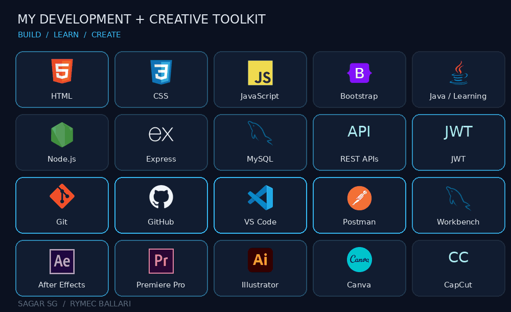

<h1 align="center">Hi, I'm Sagar SG 👋</h1>

<strong>CSE Student at RYMEC Ballari · Developer in Progress · Creative at Heart</strong>

  

  
  
  

---

## About Me

I build web applications around everyday problems and bring a creative eye to the user experience. I'm pursuing Computer Science and Engineering at **Rao Bahadur Y. Mahabaleswarappa Engineering College, Ballari**, while strengthening my Java, data structures, and algorithms skills.

My goal is to grow into a full-stack developer who can take an idea from interface design to APIs, databases, and deployment.

## 🛠️ Skills & Tools

  

| Area | Technologies |
| --- | --- |
| Frontend | HTML, CSS, JavaScript, Bootstrap |
| Backend & Data | Node.js, Express, MySQL, REST APIs, JWT |
| Development Tools | Git, GitHub, VS Code, Postman, MySQL Workbench |
| Creative Tools | After Effects, Premiere Pro, CapCut, Illustrator, Canva |

## 🌱 Currently Learning

- **Java & DSA:** strengthening programming fundamentals, problem-solving, and interview preparation.
- **Full-stack development:** improving API design, authentication, database design, and deployment workflows.
- **Next areas to explore:** AI integration, real-time features, cloud platforms, and system design.

## 🎬 Creative Work & Achievements

Alongside development, I shoot and edit videos, design event visuals, and create content that tells a story.

- **Three first-prize wins** in short-film competitions at VTU Kalaburagi.
- **Diploma hackathon winner.**
- Managed the **Rymec Hub** Instagram page and contributed filming, video edits, and promotional designs for **VIDHARA 2K26–27**, RYMEC's CSE fest.

These experiences have strengthened my teamwork, visual communication, and ability to deliver under deadlines.

## 🤝 Let's Connect

I'm interested in opportunities to learn, collaborate, and contribute to practical web projects.

- **Email:** [sgsagar572@gmail.com](mailto:sgsagar572@gmail.com)
- **LinkedIn:** [Sagar SG](https://www.linkedin.com/in/sagar-sg-5616532a1)
- **GitHub:** [sagarcreation18](https://github.com/sagarcreation18)
- **YouTube:** [@sagarsoulverse](https://www.youtube.com/@sagarsoulverse)

<!-- The animated typing banner is served by readme-typing-svg.demolab.com. -->

<!-- Skill icons: Devicon (https://github.com/devicons/devicon), MIT license. REST APIs, JWT, and CapCut use text marks. -->
